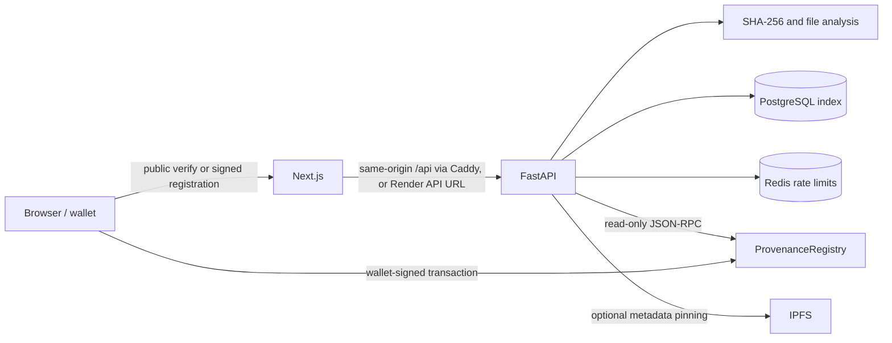

# ProofChain AI

[](https://github.com/AREEBA-NAZAR/proofchain-ai/actions/workflows/ci.yml)

ProofChain records digital-file fingerprints on an EVM-compatible blockchain and lets anyone check a file or verification ID against the public record. Files are analyzed in memory; the file itself is not uploaded to permanent storage.

> A blockchain record proves that a wallet registered a fingerprint at a point in time. It does not prove authorship or truth. AI and forensic signals are probabilistic.

## What is included

- Solidity registry for registration, version lineage, revocation, and creator identities.
- FastAPI service for SHA-256 fingerprints, safety checks, analysis, verification, trust scores, and fraud flags.
- Next.js interface for public verification, wallet registration, and an investigation dashboard.
- Wallet-signature authentication for registration analysis and record confirmation; public verification remains open.
- Per-client rate limits, optional shared Redis, and an opt-in on-chain event indexer.
- Docker deployment stack with Caddy TLS, a Render Blueprint for a generated `onrender.com` URL, and GitHub Actions CI.

## Architecture



The database is an index and cache. The contract is the source of truth for registration and revocation. The server never receives creator private keys.

## Repository layout

The application currently lives in [`proofchain/`](proofchain/):

```text
proofchain/
  backend/       FastAPI, analysis, indexer, and API tests
  contracts/     Solidity contract, Hardhat tests, and deployment scripts
  frontend/      Next.js application
  Dockerfile.*   API and web container builds
  docker-compose.yml  PostgreSQL, Redis, IPFS, API, web, and Caddy
  render.yaml    hosted demo blueprint is at the repository root
.github/workflows/ci.yml
```

## Run locally

See the [application README](proofchain/README.md) for complete setup and test commands. In short, use Node 20+ and Python 3.11–3.13, start a local Hardhat node, deploy the contract, then run the API and web app.

## Deploy without a custom domain

The root [`render.yaml`](render.yaml) provisions API and web services with platform-generated HTTPS URLs, PostgreSQL, and Redis. Render currently offers free demo resources, but free web services can sleep and free Postgres expires after 30 days; use paid persistent resources before relying on it for a public service. [Render Blueprint reference](https://render.com/docs/blueprint-spec) · [Render free-tier limits](https://render.com/docs/free).

Before creating the Blueprint, deploy `ProvenanceRegistry` to Sepolia and add the generated public deployment artifact at `proofchain/contracts/deployments/sepolia.json`. Configure the Sepolia RPC URL in the Render dashboard. The deployer key stays in the ignored local `proofchain/contracts/.env`; never put it in the repo or send it in chat. Use a Safe/multisig as `REGISTRY_ADMIN_ADDRESS` where available.

The Blueprint is a demo starting point, not a completed hosted deployment. It needs a Render account, a funded Sepolia deployer, and the deployment artifact. Hosted free tiers also sleep and may reset data.

## Model and data limitations

- Image analysis uses a third-party detector licensed CC BY-NC 4.0; it must be replaced before commercial use. The model's upstream results are not a guarantee for this application.
- No labeled evaluation corpus is included. Use [`evaluate_detector.py`](proofchain/backend/ml/evaluate_detector.py) with a separate, labeled holdout set before making accuracy claims.
- Face-swap/lip-sync and synthetic-voice models, C2PA verification, and cryptographic PDF-signature validation are not implemented.
- A registry record establishes registration priority, not authorship. The admin should be controlled by a multisig for production.

## Contributing and security

Read [CONTRIBUTING.md](CONTRIBUTING.md) before opening a change. For security issues, follow [SECURITY.md](SECURITY.md) and do not post exploitable details in a public issue.

## License

The repository code is MIT licensed. Third-party model files retain their own licenses; see the application README before redistributing or using them commercially.
